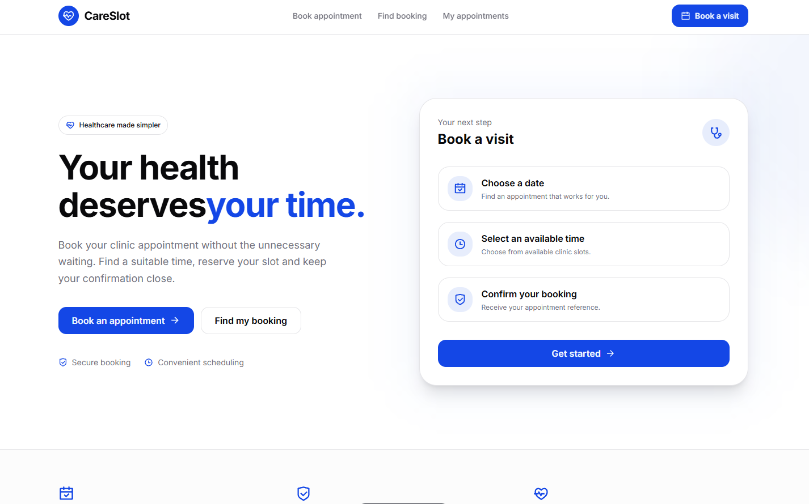

# CareSlot

CareSlot is a clinic appointment booking application. Patients can browse available appointment slots, reserve a time, look up a booking by reference, review their appointment history by email, and cancel eligible bookings.

The project is a pnpm monorepo with an Express + Prisma REST API and an Astro frontend. PostgreSQL (Neon) is the single source of truth for all bookings.



## Features

- Browse all available appointment slots, grouped by date, with an optional date filter.
- Book a slot with server-side validation and idempotent retries.
- View a booking confirmation with its reference, date, time and patient details.
- Look up an existing booking by its reference.
- List a patient's bookings by email with cursor-based pagination.
- Cancel a booking. The slot is released and the booking record is preserved.
- Rate limiting on booking creation to prevent abuse.
- API key authentication kept on the server; the browser never sees the key.

## Technology stack

| Layer          | Technology                                                        |
| -------------- | ----------------------------------------------------------------- |
| Frontend       | Astro 7, React 19 islands, TypeScript, Tailwind CSS 4, shadcn/ui  |
| Backend        | Node.js, Express 4, TypeScript, Zod                               |
| Database       | PostgreSQL (Neon) via Prisma ORM                                  |
| Tooling        | pnpm workspaces, Vitest + Supertest, ESLint, Prettier             |
| Hosting (plan) | API on Render (or similar), frontend on Vercel or Netlify         |

## Architecture

```text
Browser
  │
  ▼
Astro app (apps/web)
  ├── Static/server-rendered pages and React islands
  └── /api/clinic/[...path]  ── server-side proxy ──┐
                                                     │ adds X-API-Key
                                                     ▼
                                          Express API (apps/api)
                                                     │
                                                     ▼
                                          Prisma → Neon PostgreSQL
```

The frontend calls its own `/api/clinic/*` route. That Astro endpoint forwards the request to the Express API and injects the API key on the server, so the key is never shipped to the browser. The proxy also forwards the `Idempotency-Key` header and response headers such as `Retry-After`.

## Monorepo structure

```text
careslot/
├── apps/
│   ├── api/                      # Express + Prisma REST API
│   │   ├── prisma/
│   │   │   ├── schema.prisma
│   │   │   ├── seed.ts
│   │   │   └── migrations/
│   │   ├── src/
│   │   │   ├── config/           # env + Prisma client
│   │   │   ├── middleware/       # auth, error handling, rate limiting
│   │   │   ├── modules/
│   │   │   │   ├── slots/
│   │   │   │   └── bookings/
│   │   │   ├── routes/
│   │   │   ├── utils/
│   │   │   ├── app.ts
│   │   │   └── server.ts
│   │   ├── .env.example
│   │   └── package.json
│   │
│   └── web/                      # Astro frontend
│       ├── public/               # static assets (homepage.png, favicon)
│       ├── src/
│       │   ├── components/       # Astro + React components, shadcn/ui
│       │   ├── layouts/
│       │   ├── lib/              # clinic API client
│       │   ├── pages/            # routes, including the API proxy
│       │   └── styles/
│       ├── astro.config.mjs
│       └── package.json
│
├── package.json                  # root scripts
├── pnpm-workspace.yaml
├── documentation.md
└── README.md
```

## Prerequisites

- Node.js 22.23 or newer
- pnpm 10.16 or newer
- A PostgreSQL database (Neon free tier works)

## Local installation

```bash
# 1. Install dependencies for every workspace
pnpm install

# 2. Configure the API environment (see the next section)
cp apps/api/.env.example apps/api/.env

# 3. Generate the Prisma client, apply migrations, and seed sample slots
pnpm db:generate
pnpm db:migrate
pnpm db:seed

# 4. Start the API and the web app together
pnpm dev
```

Local URLs:

- Web: http://localhost:4321
- API: http://localhost:5000
- API health check: http://localhost:5000/health

## Environment variables

### `apps/api/.env`

| Variable       | Required | Description                                              |
| -------------- | -------- | -------------------------------------------------------- |
| `DATABASE_URL` | Yes      | PostgreSQL connection string used by Prisma.             |
| `API_KEY`      | Yes      | Expected value of the `X-API-Key` request header.        |
| `PORT`         | No       | API port. Defaults to `5000`.                            |
| `NODE_ENV`     | No       | `development` or `production`.                           |
| `DIRECT_URL`   | No       | Direct (non-pooled) database URL for migrations if used. |

### `apps/web/.env`

| Variable                | Required | Description                                                        |
| ----------------------- | -------- | ------------------------------------------------------------------ |
| `CLINIC_API_URL`        | Yes      | Base URL of the Express API, e.g. `http://localhost:5000`.         |
| `CLINIC_API_KEY`        | Yes      | API key used by the server-side proxy. Never exposed to browsers.  |
| `CLINIC_API_KEY_HEADER` | No       | Header name for the key. Defaults to `x-api-key`.                  |

> Never commit `.env` files. Keep the API key and database credentials out of the repository and out of browser code.

## Database

Prisma models (`apps/api/prisma/schema.prisma`):

- `Slot` — appointment slot, unique `id`, `provider`, `start`, `end`, `isBooked`.
- `Booking` — booking record, links to a slot, stores `name`, `email`, `status` (`confirmed` / `cancelled`).
- `IdempotencyRecord` — stores the idempotency key, request hash and original response.
- `AttemptRecord` — per-email booking attempts used by the rate limiter.

Useful commands (run from the repository root):

```bash
pnpm db:generate          # generate the Prisma client
pnpm db:migrate           # apply migrations (prisma migrate deploy)
pnpm --filter api db:migrate:dev   # create/apply a migration during development
pnpm db:seed              # reset bookings and seed sample slots
```

The seed script inserts five sample slots across two providers.

## Development commands

Run from the repository root:

| Command            | Description                                      |
| ------------------ | ------------------------------------------------ |
| `pnpm dev`         | Start the API and web app together.              |
| `pnpm build`       | Build the API and the web app.                   |
| `pnpm test`        | Run the API test suite.                          |
| `pnpm lint`        | Lint both applications.                          |
| `pnpm typecheck`   | Type-check both applications.                    |
| `pnpm db:generate` | Generate the Prisma client.                      |
| `pnpm db:migrate`  | Apply database migrations.                       |
| `pnpm db:seed`     | Seed sample slots.                               |

Per application:

```bash
pnpm --filter api dev          # tsx watch src/server.ts
pnpm --filter web dev          # astro dev
pnpm --filter web typecheck    # astro check
pnpm --filter web format       # prettier
```

## Testing

Automated API tests are intended to use Vitest and Supertest (`pnpm test`). The suite is not yet committed, so the commands currently exist but there are no test files to run.

Until then, verify the main flows manually:

1. `GET /slots` returns slots, with `available` reflecting current bookings.
2. `POST /bookings` creates a booking and returns `201` with the booking reference.
3. `GET /bookings/:id` returns the booking.
4. `GET /bookings?email=...` returns the patient's bookings with `next_cursor`.
5. `DELETE /bookings/:id` sets the status to `cancelled` and frees the slot.
6. Repeating a `POST /bookings` with the same `Idempotency-Key` and body returns the original booking instead of creating a duplicate.
7. Exceeding five booking attempts per email within a minute returns `429` with `Retry-After`.
8. In the UI, the `/book` page starts with no date selected and shows all available slots grouped by date.

Run type checks and lint before submitting:

```bash
pnpm typecheck
pnpm lint
```

## API reference

Base URL (local): `http://localhost:5000`

All `/bookings` routes require the API key header:

```http
X-API-Key: <API_KEY>
```

`/slots`, `/reset` and `/health` are not protected by the API key.

### `GET /health`

Returns `200 { "status": "ok" }`.

### `GET /slots`

Optional query: `provider` (string).

```bash
curl "http://localhost:5000/slots"
```

```json
{
  "slots": [
    {
      "id": "s1",
      "provider": "Dr Ade",
      "start": "2026-12-10T09:00:00.000Z",
      "end": "2026-12-10T09:30:00.000Z",
      "available": true
    }
  ]
}
```

### `POST /bookings`

Headers: `X-API-Key`, optional `Idempotency-Key`.

Body:

```json
{
  "slot_id": "s1",
  "name": "Ada Lovelace",
  "email": "ada@example.com"
}
```

```bash
curl -X POST "http://localhost:5000/bookings" \
  -H "Content-Type: application/json" \
  -H "X-API-Key: $API_KEY" \
  -H "Idempotency-Key: $(uuidgen)" \
  -d '{"slot_id":"s1","name":"Ada Lovelace","email":"ada@example.com"}'
```

Success: `201`

```json
{
  "id": "b_2f1c...",
  "slot_id": "s1",
  "name": "Ada Lovelace",
  "email": "ada@example.com",
  "status": "confirmed",
  "created_at": "2026-11-13T09:00:00.000Z"
}
```

Errors:

| Status | Body                                                  | Cause                                        |
| ------ | ----------------------------------------------------- | -------------------------------------------- |
| `400`  | `{ "error": "missing or invalid fields" }`            | Invalid or missing `slot_id`, `name`, `email` |
| `400`  | `{ "error": "slot has already started" }`             | The slot start time is in the past           |
| `404`  | `{ "error": "slot not found" }`                       | Unknown `slot_id`                            |
| `409`  | `{ "error": "slot already booked" }`                  | Slot was taken (atomic claim failed)         |
| `422`  | `{ "error": "idempotency key reused with different body" }` | Same key, different payload            |
| `429`  | `{ "error": "too many attempts for this email" }`     | More than five attempts per email per minute |

A `429` response includes a `Retry-After` header in seconds.

### `GET /bookings/:id`

Returns `200` with the booking, or `404 { "error": "no booking with that id" }`.

### `DELETE /bookings/:id`

Cancels the booking and releases its slot. Returns `200` with the updated booking.

- `404 { "error": "no booking with that id" }` if the booking does not exist.
- `409 { "error": "already cancelled" }` if it was already cancelled.

### `GET /bookings?email=...`

Lists a patient's bookings. Requires `email`. Optional `limit` (1–50, default 10) and `cursor`.

```bash
curl "http://localhost:5000/bookings?email=ada@example.com&limit=10" \
  -H "X-API-Key: $API_KEY"
```

```json
{
  "bookings": [
    {
      "id": "b_2f1c...",
      "slot_id": "s1",
      "name": "Ada Lovelace",
      "email": "ada@example.com",
      "status": "confirmed",
      "created_at": "2026-11-13T09:00:00.000Z"
    }
  ],
  "next_cursor": null
}
```

Pass the returned `next_cursor` as `cursor` to fetch the next page. `next_cursor` is `null` on the last page.

Errors: `400 { "error": "email is required" }`, `400 { "error": "invalid limit" }`, `400 { "error": "invalid cursor" }`.

### `POST /reset`

Development/seed helper. Replaces all slots and clears bookings.

```json
{
  "slots": [
    {
      "id": "s1",
      "provider": "Dr Ade",
      "start": "2026-12-10T09:00:00.000Z",
      "end": "2026-12-10T09:30:00.000Z"
    }
  ]
}
```

Returns `200` on success, or `400 { "error": "slots array is required" }`.

## Frontend routes

| Route             | Purpose                                                        |
| ----------------- | -------------------------------------------------------------- |
| `/`               | Landing page.                                                  |
| `/book`           | Browse available slots (grouped by date) and book one.         |
| `/booking/[id]`   | Booking confirmation or detail, with cancellation.             |
| `/lookup`         | Look up a booking by reference.                                |
| `/appointments`   | Search a patient's bookings by email with pagination.          |
| `/api/clinic/*`   | Server-side proxy to the Express API (adds the API key).       |

## Assessment levels

| Level | Scope                                       | Status      |
| ----- | ------------------------------------------- | ----------- |
| 1     | List slots, create booking, retrieve booking | Implemented |
| 2     | API key authentication, Zod validation       | Implemented |
| 3     | Concurrency protection, cancellation         | Implemented |
| 4     | Idempotency, cursor pagination               | Implemented |
| 5     | Rate limiting and request hardening          | Implemented |

Concurrency is handled with a conditional `updateMany` inside a Prisma transaction, so two simultaneous requests cannot both claim the same slot. Idempotency is stored in PostgreSQL with a unique key and coordinated with booking creation in the same transaction.

## Deployment

Deployment URLs will be added here once the API and frontend are deployed:

| Service  | URL                   |
| -------- | --------------------- |
| Frontend | _To be added_         |
| API      | _To be added_         |

Deployment notes:

- API: deploy `apps/api` as a Node service, set `DATABASE_URL` and `API_KEY`, and run `prisma migrate deploy` as a release step.
- Web: deploy `apps/web` with `CLINIC_API_URL` and `CLINIC_API_KEY` set in the host's server-side environment. Because `/api/clinic/*` is a server-rendered endpoint, the web app needs an SSR-capable host (for example Vercel or Netlify with the appropriate Astro adapter), not static-only hosting.

## Project status

- Core booking flow, lookup, cancellation, appointment history, idempotency, pagination and rate limiting are implemented.
- The automated Vitest/Supertest suite is not yet committed.
- Deployment URLs and the homepage screenshot are pending.

## Security notes

- The API key lives only in server-side environment variables. The Astro proxy injects it, so it is never sent to the browser.
- `.env` files are ignored by git. Do not commit real credentials.
- All request bodies are validated on the backend with Zod, which remains the authoritative validation layer.
